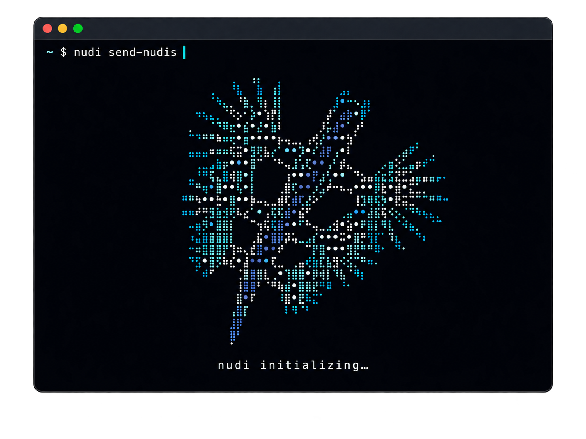
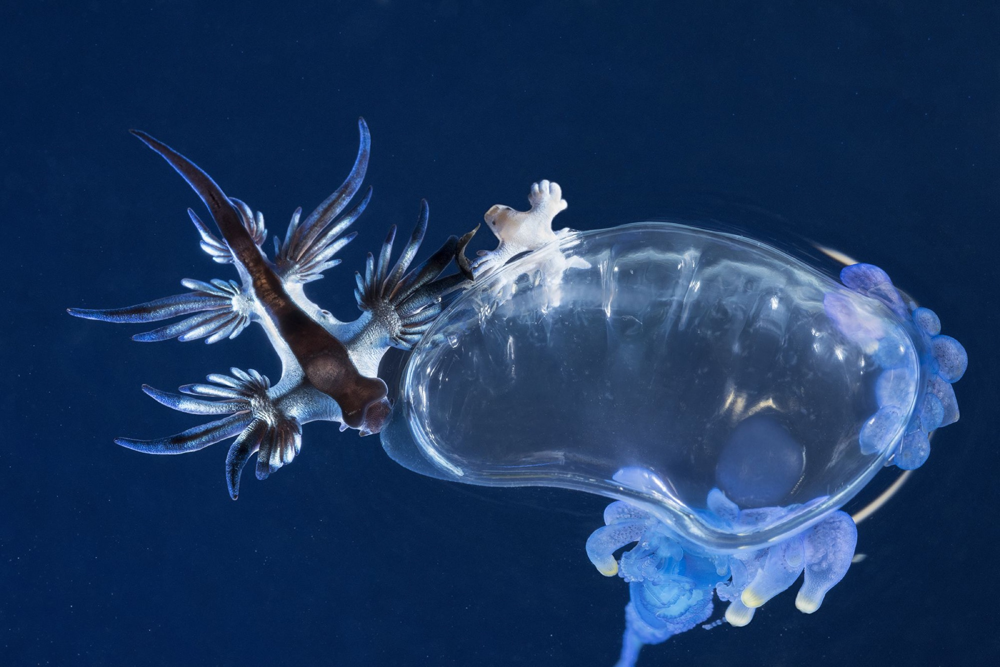

<p align="center">
  
</p>
<p align="center">
  <a href="pyproject.toml"></a>
  <a href="pyproject.toml"></a>
  <a href="LICENSE"></a>
  <a href="docs/usage.md#run-an-analysis"></a>
  <a href="docs/installation.md#optional-modal-backend"></a>
</p>

`nudi` is an open source CLI tool for red-teaming and simulating RL environments before training. It uses agent swarms to find flaws in grading. And answers how likely they are.

This readme is written by humans, for humans.
The boring stuff for your coding agents is here:  
<p align="center">
  <strong><a href="docs/installation.md">Installation</a></strong> | <strong><a href="docs/usage.md">Documentation</a></strong>
</p>

---


## How agents prevent agents reward hacking

We try to answer two questions about a selected (harbor format) environment.

1. **Pre-Hacking** "What are ways the grader can be fooled?"
	1. Agents with admin access to the raw task (dockerfile plus grader), hunt for ways how the grader could grant false responses full rewards (`hack_inspectors`).
	2. Found flaws are then tried to be reproduced by agents inside the task harness, with varied amounts of information about the flaws (full info, hint, no info).

2. **Simulations** "What are expectable agent submissions, and how well does the grader judge them?"
	1. Agents complete the training tasks (without any extra hack instruction) in isolated sandboxes. The submissions of those "simulations" are inspected by an agent. Such that we can...
		- ... compute error rates: how often grader would make flawed decisions in practice?
		- ... find new overseen flaws: coming from natural behavior, instead of directed exploit hunting.

### Pre-Hacking



#### a. Finding flaws

`hack_inspector` agents are instructed to find solutions that can pass grading without solving the intended task (false positives).
They are given admin access to the environment, fully aware of the grader.

Firstly, they search for potential behavioral false passes (e.g. when the grader only checks and accepts 3 screenshots of an animation, and outside the 3 screenshot timestamps the animations is black).

Secondly, (cyber) reward hacks, known from prior research, are accounted for:
- Leaked answers in files, Git history, or upstream fixes.
- Reference packages used as answer oracles.
- Fabricated outputs that satisfy tests without solving the task.
- Tampering with tests, helper packages, or reward files.
- Timing tricks or persistent state that interfere with grading.

Every found flaw is executed in another isolated sandbox, so a suspected flaw can be "reproduced".
#### b. Could agents in execute the flaw in realistic training-like situations?

Loophole existence does not imply exploitability through the original environment harness.
So, for every flaw found by a `hack_inspector`, `attacker` agents instructed to exploit the environment are dispatched.

Each `attacker` gets a fresh sandbox with the original environment tools and permissions. We add a meta system prompt with the goal to solely exploit the environment.

Disclosure on found flaws is cascaded into three levels.
- **i)** Full privileged information on how to exploit the found loophole.
- **ii)** A minimal hint on what hack type to focus on, such as pointing to a file in the environment.
- **iii)** No extra information.

The nuanced exploit report is more informative than binary claims (hackable / not hackable).

### Simulation



#### a. Generate realistic trajectories
A set of `simulator` agents (default: `n=20`) execute the task in isolated containers with real environment configurations.
Their trajectories are then assessed.
#### b. Trajectory statistics

##### i. Reward Distribution
Descriptive Statistics on the simulated rewards, to flag potential issues with the environment.  
For example, `nudi` flags scenarios, where the mean and standard deviation of the reward distribution are both high (+ left-skewed).
It's weird, that the models overall had an easy time solving the task, yet few performed badly. It's a sign (≠ cause), for ambiguous systems prompts or overspecified graders.

##### ii. Grader Classification Analysis
An `inspector` agent with full admin access to the environment (including the grader) analyzes the outcomes and traces of the simulators.

Labels assigned to each simulation:
- `false_negative`: grader rejects work that (semantically) should've fulfilled task requirements
- `false_positive`: grader accepts work that should not have passed.
- `true_positive`: task successfully completed as intended and grader passes.
- `true_negative`: task failed, and did definitely not pass the requirements.
- `unresolved`: inconclusive; kick off another Inspector for better conclusion.

The labels are then used to compute FDR and FNR.

| Metric                                | Interpretation                                                   | Impact                                                                                                                             |
| ------------------------------------- | ---------------------------------------------------------------- | ---------------------------------------------------------------------------------------------------------------------------------- |
| **False discovery rate** [FP/(TP+FP)] | Of positively rewarded runs, how many didn’t deserve the reward? | Contamination with fake successes in positive training signal ($\Rightarrow$ directly inviting reward hacks)                       |
| **False negative rate** [FN/(TP+FN)]  | Of valid runs, how many were rejected?                           | Correct submissions are not reward ($\Rightarrow$ indirectly inviting reward hacking, when agent gets fed up with impossible task) |

(For now, it's only compatible with pass/fail graders. Rubric based environments are not covered by this analysis yet.)
### Featuring

- Agent-first CLI & Python Library
- TUI for humans, with live progress
- Harbor Environments: Ran through native Harbor
- Modal Sandboxes: Built for cloud sandboxes.
- Parallelization: Parallel sandboxes, automatically scheduled and (if ran locally) constrained by available CPU/RAM. (i.e. inspector on flaw B would run in parallel with attackers of flaw A.)
- Reports with rewards, traces, and evidence for each finding (optimized for coding agents)
- Bring your own model... inference through any OpenAI-compatible API
- Everything configurable
	- What to run (full analysis vs. only pre-hacking, vs. only simulations.)
	- Intensity of search: number of simulations, tries per flaw, etc.
	- Spending cap & Time limit

### Soon to be released

- Concurrent inspection of multiple environments.
- Outer loop for autonomous patching: Find flaws, patch them, test again. Terminate with a patch report, when no new flaws found.
- More environment framework integrations: [verifiers](https://github.com/PrimeIntellect-ai/verifiers), [verl](https://github.com/XiaomiMiMo/verl), [hud](https://github.com/hud-evals/hud-python)

## "Agentic Uno Reverse Card" inspired by real-life Pokemon

**Nudibranchs** are sea slugs that evolution has formed into some of the most aesthetically appealing water creatures. But most importantly, they evolved into *weapon theft (kleptocnidy)*.

So, they share their habitat with some jellyfish species. Those species prey approaching fish by stinging them with nematocysts; which are poison capsules, that explode inside the enemies body.

Nudibranchs like *Glaucus atlanticus* eat (parts of) the jellyfish. They are able to swallow unexploded nematocysts, and repurpose the arsenal as their own shield.



## Citation

Originally created by Mohid Butt ([@unlearning_rate](https://x.com/unlearning_rate)).

```bibtex
@misc{nudi2026,
  author       = {Mohid Butt},
  title        = {nudi: Red-teaming and simulating RL environments before training},
  year         = {2026},
  howpublished = {\url{https://github.com/standardnormal-ai/nudi}}
}
```
